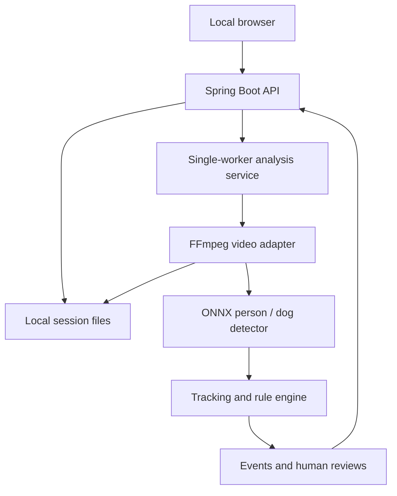

# Architecture and design — Phase 1

## Goal and boundary

A user runs a Java service and browser UI on their Windows x64 computer,
loads a recording exported from a fixed camera and reviews observable events.
Existing DVR recording remains independent. No DVR password, router password,
static IP or cloud connection is needed for uploaded-file analysis.

## Maven boundaries

| Module | Responsibility | Dependencies |
| --- | --- | --- |
| domain | Immutable records, schedules, tracking and rules | JDK only |
| video | File probing, thumbnail, silent preview, sampled RGB frames | domain + external FFmpeg |
| detection | Detector interface, YOLOv10 preprocessing/output decoding | domain + ONNX Runtime |
| service | Bounded upload sessions, jobs, cancellation, review lifecycle | domain, video, detection |
| app | Local HTTP API, configuration, browser UI and request guard | service + Spring Boot |

Java owns orchestration and model inference. FFmpeg is a child process, invoked
with an argument list and no shell interpolation. The earlier OpenCV proposal
is replaced by FFmpeg for Phase 1 decoding and browser-compatible conversion;
no OpenCV dependency is required for the current object model.

## Processing lifecycle

1. Multipart upload is streamed to a server-generated UUID folder. The original
   name is display-only. Extension is checked and FFprobe validates content.
2. Probe applies duration/resolution limits; FFmpeg extracts the first image.
3. User submits a rectangle in original-frame fractions and rule configuration.
4. Service admits one job, opens and validates a real model, fingerprints it,
   prepares silent H.264 preview, then samples RGB frames at 2 FPS.
5. `setpts=PTS-STARTPTS` aligns preview and analysis at zero. Letterbox to
   640x640 preserves aspect ratio with RGB 114 padding; output coordinates are
   mapped back to original-image fractions. Rotation metadata is deliberately
   not auto-applied, appropriate for fixed DVR recordings.
6. A greedy one-to-one IoU tracker matches labels, expires tracks after 1.5s
   without a match and feeds the rules engine. This is not re-identification.
7. Events retain UUIDs while their observed end time updates. Reviews survive
   subsequent updates. The user can play each interval with three seconds of
   context on each side, and export the job as JSON.
8. Cancellation stops child processes and retains partial findings. Deletion
   is allowed once analysis is idle. Shutdown closes sessions and removes media.

## Rule semantics

- Area membership uses a detection's bottom centre, as an approximate foot point.
- Presence requires a configurable observed duration (minimum 1 second).
- Lingering is a longer duration for the same short-term track in the area.
- Repeated entries counts entry episodes in the area, with a window-length
  cooldown. It does not say the same person returned.
- Person/dog proximity requires both detections inside the area and a small
  gap between their image rectangles for a duration. This is 2D proximity,
  not physical distance, and does not establish feeding. Default gap is .08
  in normalised image coordinates and is available in the API as `proximity`.
- Every rule uses the same monitoring window for this job. To flag feeding
  outside preferred hours, configure the monitoring hours to the unwanted
  interval. Arbitrary multiple intervals and separate schedules are future work.
- Schedule end is exclusive. Equal start/end means all day. Empty day list
  means every day. Overnight early-morning time belongs to the previous day.
- UI schedules run every day; the API additionally accepts weekday selection.
- Time is user-supplied fixed UTC offset + clip position, not OCR/extracted
  camera time. DST-changing long periods are not covered by this 30-minute MVP.
- Detection confidence is the latest person model score, not an event certainty
  or probability of wrongdoing. No automated accusation or rejection is made.

## Storage and concurrency decisions

Session media is local disk; configuration, jobs and reviews are in memory.
No database or customer-data cloud upload is required. JSON schema version 1
allows future readers to distinguish formats. Job/video/event UUIDs avoid
accidental filename collisions. No report import is implemented yet.

Limits: 250MB, 30 minutes, max 4096x4096, five videos, twenty jobs, one worker,
2,000 findings/job. Native tensors/results/session use close scopes. Frames
are handled one at a time with pipe backpressure. Process timeouts and a
cancellation watchdog prevent decoder hangs from running indefinitely.
An ONNX call already in progress must return before job cancellation completes.

## Local security boundary

Bind 127.0.0.1. Enforce loopback Host, same Origin when present, and a custom
header for mutations; do not enable CORS. Browser assets are same-origin with
CSP, no remote scripts. Files use UUID paths, arbitrary file reads are absent,
and FFmpeg input protocols are restricted to local files/pipes. The model is
administrator-supplied and the setup download is checksum verified.

This phase has no user authentication, TLS deployment, Android client, remote
notifications or multi-user isolation. These are concrete prerequisites for
network hosting, not configuration switches to enable casually. The repository
is public; user footage must remain outside Git.

## Known limitations

Sampling misses fast actions. IoU tracking fragments when objects move quickly,
are occluded, or cross; it can also swap tracks. Shadows, small distant dogs,
night imagery and compression lower detection quality. Dwell estimates can
include short gaps up to tracker expiry. Validate results against original
footage; no target precision/recall has yet been established for this camera.
